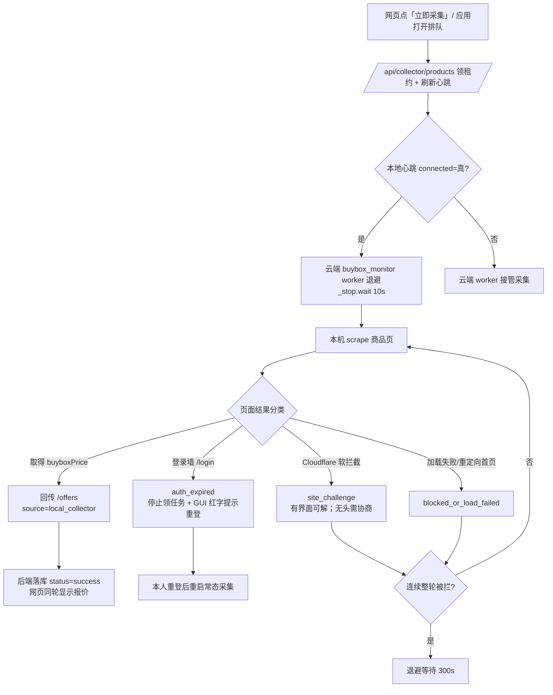

# Takealot 本机采集系统 — 统一设计方案（视觉逻辑系统）

> 协作基线文档，供 WorkBuddy 与 Codex 对齐。覆盖：采集调度逻辑、会话失效检测（新增）、人机验证处理边界、前端视觉逻辑一致性，以及一张全局逻辑图。

## 1. 总体定位与红线

- **只采集行情**（Buybox 报价 / 现货状态）。调价由系统单独控制链路完成，采集器绝不触发。
- **红线（不可逾越）**：不改真实售价、不开真实调价、不创真实采购、不取消 SKU 身份校验、不读取/上传密钥内容（DPAPI 仅内存解密后注入 `PP_COLLECTOR_KEY`）。
- **身份**：采集器以「本人已登录的 Takealot 会话」访问，等价于真人手动看页面。**不做验证码破解、不做浏览器指纹伪装**。

## 2. 采集调度逻辑（已与 Codex 对齐更正）

`collector_routes.py` 定义心跳：`HEARTBEAT`(本地,900s)、`BROWSER_HEARTBEAT`(扩展,90s)、`CLAIM_PREFIX`。`connected(db)` 任一未过期即真。后端 `buybox_monitor.start_worker` 见 `connected(db)=真` 则 `_stop.wait(10); continue` **主动退避** —— 「本地在线优先」是设计意图，不是 bug。

- 本机经 `/api/collector/products` 领租约（CAS 更新，≤20 个），`/offers` 回传 `source='local_collector'`。
- **根因（已修复）**：GUI 原先只有「采集一轮」=`--once`，本地跑完一轮即退出，心跳空窗被常驻云端 worker 抢走任务 → 点「采集一轮」常报「暂无到期任务」。新增「常态采集」持续模式让本地心跳常驻、云端退避、本地优先领租约。

## 3. 会话失效检测机制（本次新增）

**触发**：Takealot 会话过期 → 商品页跳转到 `/login` 或出现登录入口（而非被风控拦截）。

**采集器侧**（`collector.py`）：
- `is_auth_expired(page)`：识别登录 URL / 标题含 sign-in·log-in / 密码框+登录入口。
- 在 `scrape()` 的 `finally` 中，若未取得 `buyboxPrice` 且命中登录墙 → `error='auth_expired'`（**优先于** `site_challenge`，因为登录墙需要本人重登而非被风控）。
- `round_once` 置位 `auth_event` 并打印 `AUTH_EXPIRED:` 机器可读行。
- `run()` 在 `auth_event` 置位后**停止领任务、打印提示、退出**（心跳停止 → 云端 worker 自然接管，不空跑、不误导）。

**GUI 侧**（`gui.py`）：`poll()` 检测 `AUTH_EXPIRED:` 行 → 状态栏红色提示「⚠️ 登录会话已失效：请点『登录 / 配送设置』重新登录，然后再次『常态采集』」。用户重登后重新启动即可。

**边界**：不自动打码、不伪装；只提示本人重登。

## 4. 人机验证（反爬）处理边界

| 现象 | 性质 | 处理 |
|---|---|---|
| `site_challenge`（Cloudflare "Just a moment…"） | 软拦截，多由 **无头指纹** 触发 | 默认用**有界面 + 本人会话**（R269 实测成功）；不靠破解 |
| 硬验证码（真人需点） | 安全验证 | **由本人会话手动过验证**，机器不绕过 |
| 会话过期登录墙 | 会话态 | `auth_expired` 检测 → 提示重登 |
| 连续整轮被拦 | 风控升档风险 | 退避：连续 2 轮全拦截则等待拉长至 300s |

**明确不做**：验证码识别 / 打码平台接入、无头指纹伪装以绕过站点安全控制。理由：违反 Takealot ToS、极脆弱（对方一升级检测即全崩）、踩「绕过访问控制」红线。

**正当加固**：会话失效检测 + 拟人节奏（单标签页 / ~30s 一轮 / 随机会话间隔）+ 风控整轮回退避。

## 5. 前端视觉逻辑一致性

- **React（`src/utils/imageFallback.tsx`）**：`imageErrorPlaceholder` → `ProductImage` 组件（state 驱动占位，`useEffect` 重置失败态），Inventory / ProductCreate / ProductDetail / ProductList ×2 共 4 处统一调用；`tsc` 0 错、`vite build` 通过、Playwright 回归 20/20。
- **原生 GUI**：状态栏统一四类可视状态（连接中 / 采集中 / 已暂停 / **会话失效红色**）；失败信息可观测。
- **统一原则**：失败不污染成功（宁可采不到也不采错 —— 选择器宁缺毋滥）；诊断透传（`diagnostics` 含 http_status / buybox_cards / page_title / final_url）。

## 6. 视觉逻辑系统图

## 7. 待 Codex 决策 / 协作项

1. **无头风控**：是否采用新版 headless + 去自动化特征参数做无人值守；还是默认有界面（当前选择）。
2. **后端状态码**：是否新增 `auth_expired` 状态（让 Web UI 也弹重登横幅），与现有 `status='error'` 区分。
3. **接管时延**：本地崩溃/退出后云端需等 900s 心跳过期才接管，是否加更短健康心跳。
4. **会话检测阈值**：`is_auth_expired` 的判定是否需结合后端 Seller API 校验会话有效性。
5. **合并路径**：本分支（native-collector 修复）与 React 复核分支的合入顺序。
